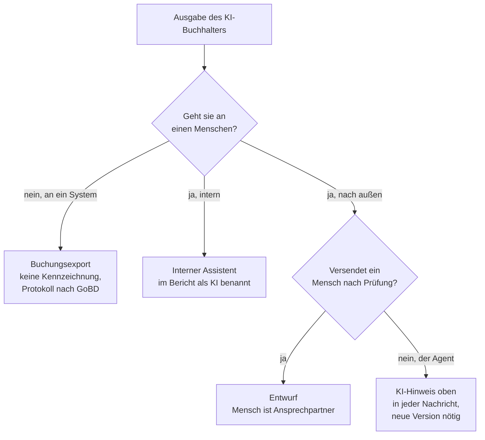

# Rechtsrahmen: KI-Buchhalter

[FIRMA] · Version der Agentendatei: 1.21 · geprüft von: [NAME VORGESETZTER] · Datum: [DATUM]

<!-- Grundlage: Kapitel 23 (Stand 19.10.2026), Bausteine B-23.1, B-23.2, B-23.5, B-08.4, B-16.3, B-08.1. -->

> **Keine Rechtsberatung.** Diese Prüfliste zeigt die Grundlinien aus Kapitel 23 am KI-Buchhalter. Lassen Sie die Einrichtung von Ihrer Datenschutzbeauftragten abnehmen. Die steuerlichen Punkte gelten vorbehaltlich der Prüfung durch Ihren Steuerberater.

## 1 Datenschutz (23.1, B-23.1)

Fast jeder Beleg enthält personenbezogene Daten. Die DSGVO gilt vom ersten Beleg an. Vier Grundsätze: nur für den Zweck, für den der Agent den Beleg bekommt · nur, was er dafür braucht · nur in Diensten, die dafür freigegeben sind · keine Entscheidung über Menschen.

| ✓ | Prüfpunkt vor dem ersten echten Beleg | Antwort / Nachweis |
|---|---|---|
| [ ] | Verarbeitung im Verzeichnis der Verarbeitungstätigkeiten eingetragen? | [NAME DATENSCHUTZ, ROLLE], [DATUM] |
| [ ] | Vertrag zur Auftragsverarbeitung mit dem Anbieter, Nutzung der Daten zum Training ausgeschlossen? (Tarif und Vertrag: Kapitel 10.5) | |
| [ ] | Wo werden die Daten verarbeitet und gespeichert? Datenhaltung in der EU, wo angeboten; bei Übermittlung in die USA: Anbieter im Verzeichnis des EU-US Data Privacy Framework? (Verfahren beim Europäischen Gerichtshof anhängig) | |
| [ ] | Wer im Unternehmen sieht welche Daten, auch in den Protokollen? (Zugriffsmatrix Kapitel 8.3) | |
| [ ] | Wie werden Auskunfts- und Löschbegehren behandelt, soweit Aufbewahrungspflichten nicht entgegenstehen? | |
| [ ] | Geteiltes Gedächtnis: kein Gedächtnis über Personen und Vorgänge hinweg, Zustand nur in der eigenen Ablage (B-13.8) | |
| [ ] | Keine Entscheidung über Menschen (Art. 22 DSGVO): keine Mahnsperre, kein Kreditlimit, keine Lohnbestandteile; ein freigegebener Buchungsvorschlag ist keine solche Entscheidung | |

Hinweise aus der Quelle: Orientierungshilfen der Datenschutzkonferenz zu KI allgemein, zu technischen und organisatorischen Maßnahmen und (Oktober 2025) zu Systemen mit Wissensabruf; die letzte ist für Wissens-MCP-Server einschlägig. Eine eigene Orientierungshilfe zu Agenten gab es bei Redaktionsschluss nicht. Eine Reform der DSGVO im Digital Omnibus ist nicht beschlossen.

## 2 KI-Verordnung (23.2, B-23.2)

Verordnung (EU) 2024/1689, im Juli 2026 durch den Digital Omnibus zur KI-Verordnung geändert.

| Seit / ab | Was gilt | Bedeutung für den KI-Buchhalter |
|---|---|---|
| 02.02.2025 | Verbotene Praktiken, KI-Kompetenz | Verbote betreffen ihn nicht; Beschäftigte schulen |
| 02.08.2026 | Allgemeine Geltung, darunter Kennzeichnung nach Art. 50 | siehe Teil 3 |
| 02.12.2027 | Pflichten für Hochrisiko-Systeme nach Anhang III | nur, wenn ein Hochrisiko-Zweck dazukommt |

Die Fristen folgen der Verordnung (EU) 2026/1744 (Digital Omnibus zur KI-Verordnung), in Kraft seit 27.07.2026. Aufsicht in Deutschland seit Juli 2026: Bundesnetzagentur, für den Finanzsektor die BaFin.

| ✓ | Prüfpunkt | Antwort / Nachweis |
|---|---|---|
| [ ] | KI-Kompetenz: Schulung der Freigebenden dokumentieren (Nachweis); ein bestimmtes Niveau ist seit Juli 2026 nicht mehr vorgeschrieben | |
| [ ] | Risikoklasse: **Einschätzung:** kein Hochrisiko-System, solange er Belege kontiert und Buchungen vorschlägt und keine Menschen bewertet | |
| [ ] | Ausgeschlossene Zwecke (B-23.2): keine Bewertung der Kreditwürdigkeit natürlicher Personen, keine Bewertung von Leistung oder Verhalten von Beschäftigten, keine Verteilung von Aufgaben nach persönlichen Merkmalen; als Negativfall im Abnahmetest (N-10 in DL-110) | |
| [ ] | Rolle: Betreiber (fertige Plattform) oder Anbieter (eigener Agent über die Schnittstelle eines Modells, unter eigenem Namen im Haus in Betrieb). **Einschätzung:** auf der Stufe „Für technische Umsetzer“ wahrscheinlich Anbieter (nach dem Entwurf der Leitlinien der Kommission). Mit Rechtsberatung klären | [ ] Betreiber [ ] Anbieter · geklärt mit [NAME], [DATUM] |

Käme ein Hochrisiko-Zweck dazu, gälten ab Dezember 2027 für Betreiber unter anderem: Nutzung nach Gebrauchsanweisung, menschliche Aufsicht durch kompetente Personen, Kontrolle der Eingabedaten, Aufbewahrung der Protokolle über mindestens sechs Monate, Information der Arbeitnehmervertretung vor dem Einsatz am Arbeitsplatz, gegebenenfalls Datenschutz-Folgenabschätzung. Das wäre ein anderer Agent mit neuer Prüfung.

## 3 Kennzeichnung nach Art. 50 (23.3, B-08.4)

Seit 02.08.2026: Wer mit einem KI-System direkt interagiert, muss erfahren, dass es eine KI ist, außer das ist offensichtlich (Pflicht des Anbieters). Generierte Inhalte sind maschinenlesbar als KI-erzeugt zu markieren, mit Ausnahmen etwa für kurze Zeichenfolgen, Quellcode und reine Datenübergaben zwischen Maschinen (Pflicht des Anbieters). Betreiber kennzeichnen unter anderem KI-erzeugte Texte, die die Öffentlichkeit über Angelegenheiten von öffentlichem Interesse informieren, außer ein Mensch hat sie inhaltlich geprüft und trägt die redaktionelle Verantwortung. Leitlinien der Kommission zu Art. 50: Inhalt im Juli 2026 gebilligt; formal angenommen erst mit allen Sprachfassungen; nicht bindend, geben aber die Richtung vor (Stand 19.10.2026).

*Nach Abbildung 23.1 (Einschätzung nach dem Leitlinien-Entwurf der Kommission, keine Rechtsberatung).*

| ✓ | Ausgabe | Geht an | Kennzeichnung / Maßnahme |
|---|---|---|---|
| [ ] | Bericht und Vorschläge (interner Assistent) | intern, Buchhaltung | nennt sich in jedem Bericht eine KI (B-08.4) |
| [ ] | Buchungsstapel und ausgelesene Belegdaten | System | **Einschätzung:** keine Kennzeichnung nötig; Protokoll nach GoBD (Teil 4) |
| [ ] | Kundenkorrespondenz, etwa Zahlungserinnerung | nach außen, nur als Entwurf | Mensch prüft und versendet; selbstständiger Versand in dieser Version nicht vorgesehen (B-08.4) |
| [ ] | Monatsbericht an die Geschäftsführung | intern, Zusammenfassung | wer Anbieter ist: maschinenlesbare Markierung einplanen |

Würde der Agent selbst versenden: neue Version der Agentendatei, KI-Hinweis oben in jeder Nachricht, Abnahmetest mit Kundenantworten, Regel für Rückfragen. Bußgelder bei Verstößen gegen Art. 50 bis 15 Mio. € oder 3 % des weltweiten Jahresumsatzes, für kleine und mittlere Unternehmen jeweils der niedrigere Betrag.

## 4 Nachvollziehbarkeit nach GoBD (23.4, B-16.3)

| ✓ | Was der KI-Buchhalter liefert | Was das Unternehmen sicherstellt | zuständig |
|---|---|---|---|
| [ ] | Protokolleintrag zu jedem Vorschlag und jeder Freigabe (B-16.3) | unveränderbare Ablage mit Prüfsumme und Zugriffsschutz | [NAME, ROLLE] |
| [ ] | verwendete Regel und Wissensstand zum Belegdatum | Versionierung und Aufbewahrung des Muss-Wissens selbst | [NAME, ROLLE] |
| [ ] | bei E-Rechnungen die Daten aus dem XML-Teil | Aufbewahrung des strukturierten Teils und, wo nötig, des Bildteils | [NAME, ROLLE] |
| [ ] | ausgelesene Daten zur Prüfung | Prüfung und Aufbewahrung der geprüften Ergebnisse | [NAME, ROLLE] |
| [ ] | Buchungsstapel ohne Festschreibung | Festschreibung, Abschluss und Übermittlung durch Befugte | [NAME, ROLLE] |
| [ ] | Testberichte zu jeder Version (B-17.4) | Verfahrensdokumentation mit Versionen, Tests und Freigaben (DL-111) | [NAME, ROLLE] |

Aufbewahrung nach § 147 AO: Belege acht Jahre · Bücher, Jahresabschlüsse und Organisationsunterlagen einschließlich Verfahrensdokumentation zehn Jahre · Protokolle des Agenten: **Einschätzung:** zehn Jahre (Empfehlung des Buches). Beispiel. Stimmen Sie die Einordnung für Ihr Unternehmen mit Ihrem Steuerberater ab. Ein Chatverlauf ist kein Archiv.

## 5 Steuerberatungsrecht und Haftung (23.5, B-23.5, B-08.1)

Konstellation: [x] Selbsthilfe (eigene Belege, keine Befugnis nötig) [ ] Steuerberater mit Agent (Befugnis und Verantwortung beim Steuerberater; ein späterer Band) [ ] Anbieter für andere Unternehmen (Befugnis oder verantwortende qualifizierte Person; eigene Rechtsberatung nötig)

Vorschriften laut B-08.1 (Kapitel 8.1): Seit dem 01.09.2026 ist das Kontieren von Belegen nach § 2 Abs. 3 S. 2 StBerG Hilfeleistung in Steuersachen. Für andere Unternehmen ist es nur Befugten erlaubt oder unter Verantwortung einer qualifizierten Person (§ 6 Abs. 1 Nr. 1 StBerG); die Umsatzsteuer-Voranmeldung ist in § 6 Abs. 1 Nr. 1 nicht genannt. Der KI-Buchhalter arbeitet nur für [FIRMA] (B-23.5).

Haftung (Quelle: gesetze-im-internet.de, Stand 19.10.2026; keine Rechtsberatung): Die steuerlichen Pflichten erfüllen die gesetzlichen Vertreter, bei einer GmbH die Geschäftsführung. Nach § 69 AO haften sie, soweit Ansprüche aus dem Steuerschuldverhältnis infolge vorsätzlicher oder grob fahrlässiger Verletzung der ihnen auferlegten Pflichten nicht oder nicht rechtzeitig festgesetzt oder erfüllt werden; die Haftung umfasst auch die Säumniszuschläge. Eine leichtfertige Steuerverkürzung ist nach § 378 AO eine Ordnungswidrigkeit und kann mit einer Geldbuße bis zu fünfzigtausend Euro geahndet werden. Der Agent verschiebt die Pflicht nicht.

| ✓ | Sorgfaltsnachweis | Nachweis (Dokument, Version) |
|---|---|---|
| [ ] | Vorgangsarten festgelegt, die der Agent bearbeitet und nicht bearbeitet | Stellenprofil, B-03.1, Reifegrad DL-131 |
| [ ] | Nur die nötigen Rechte vergeben | Zugriffsmatrix (Kapitel 8.3), B-08.3 |
| [ ] | Wertgrenzen und Freigaben festgelegt und durchgesetzt | B-08.2, Einrichtungsprotokoll |
| [ ] | Vor dem Einsatz getestet, nach jeder Änderung erneut | Abnahmetest DL-110, B-17.4 |
| [ ] | Protokolle und Kennzahlen regelmäßig ausgewertet | Laufbericht B-03.3, Monatsbericht |
| [ ] | In die Verfahrensdokumentation aufgenommen | DL-111 |

Textbaustein (B-23.5): „Das sind Vorschläge, keine Steuer- oder Rechtsberatung. Verantwortlich für Buchführung, Voranmeldung und Aufbewahrung bleibt [FIRMA].“

Fragen zur Steuergestaltung beantwortet der Agent nicht; er legt sie mit den bekannten Fakten dem Steuerberater vor, ohne Empfehlung.

## Abnahme
| Stelle | Name | Datum | Ergebnis |
|---|---|---|---|
| Datenschutzbeauftragte | [NAME DATENSCHUTZ] | | |
| Prüfung durch Ihren Steuerberater | [NAME STEUERBERATER] | | |
| Rechtsberatung (Rolle nach KI-Verordnung) | [NAME] | | |
